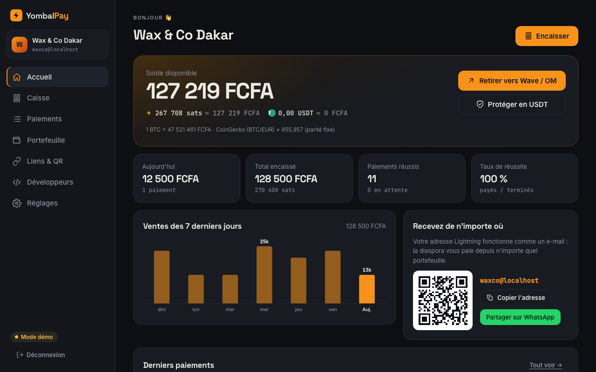
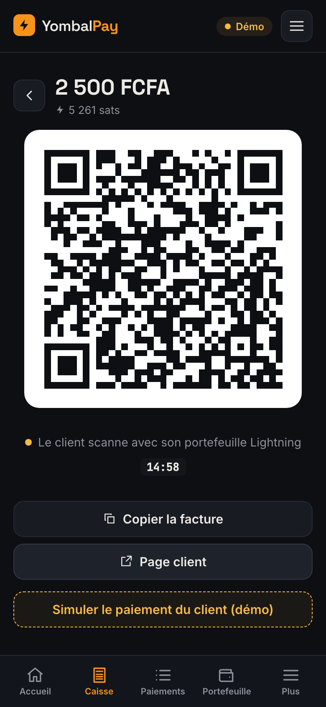
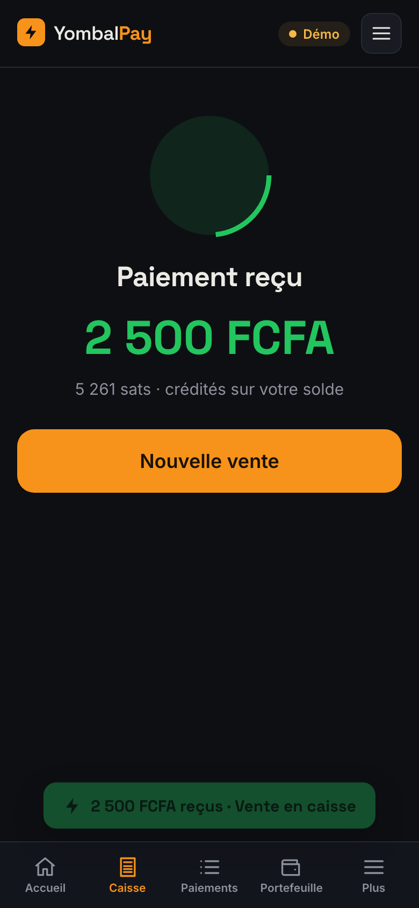
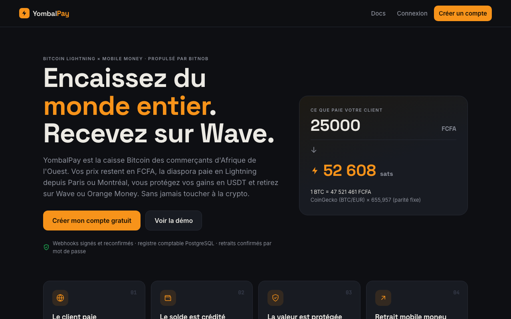
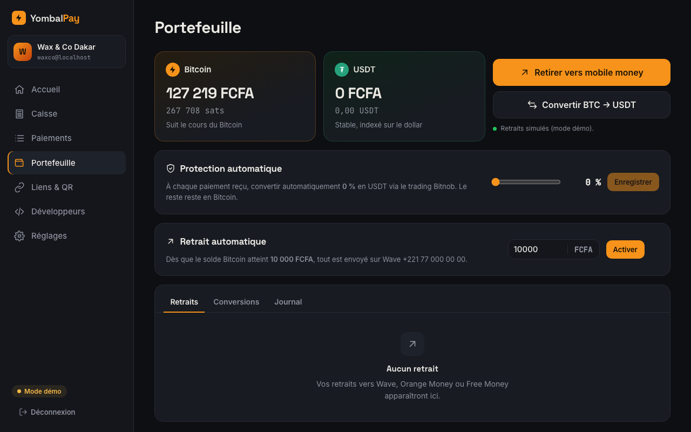
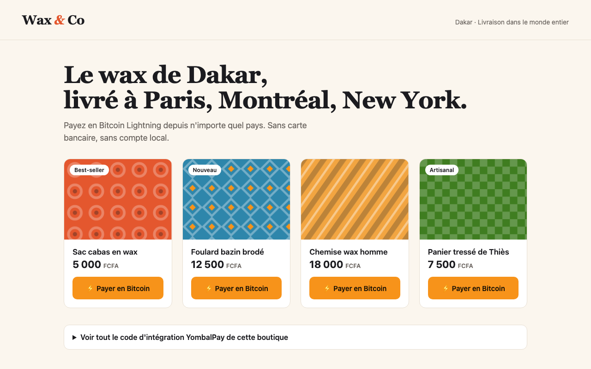

# YombalPay : encaissez du monde entier, recevez sur Wave

[](https://github.com/ODIA221/yombal_pay/actions/workflows/tests.yml)

**La caisse Bitcoin des commerçants d'Afrique de l'Ouest.** Le commerçant affiche ses prix en FCFA. Son client paie en Bitcoin Lightning depuis n'importe quel pays. La valeur est protégée en USDT, puis retirée sur Wave, Orange Money, Free Money ou Expresso. Le commerçant n'a jamais à toucher à la crypto.

Construit sur l'API **Bitnob** (Lightning, Trading, Payouts) pour Code & Chain Dakar 2026.

| Espace marchand | Caisse mobile | Paiement reçu |
|---|---|---|
|  |  |  |
|  |  |  |

## Le problème

- **Aïssatou tient African Costume Shop à Dakar : grands boubous, bazin et kaftans cousus main.** Sa meilleure cliente, Fatou, vit à Paris. Fatou n'a pas de compte Wave sénégalais, la petite boutique n'accepte pas sa carte, et les passerelles Bitcoin étrangères ne versent pas un franc CFA. La vente ne se fait pas.
- **Les commerçants ont peur de la volatilité** et ne savent pas transformer des sats en argent utilisable.
- **Intégrer Bitnob en direct** demande de gérer la signature HMAC, la conversion FCFA, les webhooks, les doublons, la comptabilité et les retraits. Il faut des jours de travail.

## La solution : la boucle complète

```
Client (n'importe où) ── Lightning ou USDT ──▶ YombalPay ──▶ Solde FCFA ──▶ USDT (anti-volatilité) ──▶ Wave / Orange Money
                                       Bitnob Lightning          Bitnob Trading            Bitnob Payouts
```

| Pour encaisser | Pour gérer | Pour les développeurs |
|---|---|---|
| **Caisse mobile** : pavé numérique en FCFA, QR, son à l'encaissement, application installable | **Solde en FCFA** : BTC et USDT, registre comptable | **API REST + SDK Node + bouton** en une balise |
| **Adresse Lightning** `boutique@domaine` (LNURL-pay, LUD-16/12/21) | **Conversion USDT** manuelle ou automatique (% de chaque paiement) | **Webhooks signés** HMAC-SHA256 avec retries |
| **Page publique** `/@boutique` à montant libre, **affiche QR** à imprimer | **Retraits** Wave / Orange Money / Free Money / Expresso | **Clés révocables**, stockées hachées |
| **Liens de paiement** WhatsApp à montant fixe | Graphique des ventes, export CSV, preuve de paiement | Journal des notifications, renvoi manuel |
| **« Payer pour un proche »** (diaspora), pages client **FR / EN** | **Retrait automatique** dès qu'un seuil est atteint | **Plugin WooCommerce** (`integrations/woocommerce`) |
| **Comptes caissiers** : caisse et ventes uniquement | Journal d'activité du compte | |
| **Paiement en USDT / USDC** (Tron, BNB Chain, Polygon) : adresse de dépôt Bitnob par paiement | **Paiements USDT crédités en USDT** : aucune volatilité | |
| **Reçu de paiement** imprimable / PDF, avec preuve et QR de vérification | **Épargne en USDT** : objectif (Tabaski…), % de chaque vente mis de côté, déblocage par mot de passe | |
| **Frais évités** affichés au client avant et après paiement | **Compteur d'impact** : total des frais évités par vos clients | |

## Démarrage

```bash
./run.sh           # installe tout, crée la base, construit le front, lance passerelle :3000 + boutique :4000
./run.sh test      # 101 tests de bout en bout (base PostgreSQL locale « yombal_pay_test »)
./run.sh dev       # API rechargée à chaque modification + Vite :5173 + boutique
./run.sh check     # diagnostic de la connexion Bitnob
./run.sh reconcile # rapprochement comptable : registre ↔ opérations, puis plateforme ↔ compte Bitnob
```

**Sous Windows**, utilisez `run.bat` avec les mêmes commandes (`run.bat`, `run.bat test`, `run.bat dev`, `run.bat check`) dans l'invite de commandes ou PowerShell (`.\run.bat`). Le plus simple est d'utiliser Supabase (`DATABASE_URL`). Avec un PostgreSQL local, indiquez l'utilisateur et le mot de passe : `DATABASE_URL=postgres://postgres:<mot-de-passe>@localhost:5432/yombal_pay`, et pour les tests `TEST_DATABASE_URL=postgres://postgres:<mot-de-passe>@localhost:5432/yombal_pay_test`.

- Site et espace marchand : http://localhost:3000. Compte de démo : identifiants `DEMO_MERCHANT_EMAIL` / `DEMO_MERCHANT_PASSWORD` de votre `.env`.
- Boutique de démo : http://localhost:4000
- Sans clés Bitnob, tout fonctionne en **mode démo** (factures simulées, bouton « Simuler le paiement »).

### Base de données : Supabase

1. Créez un projet sur supabase.com.
2. Copiez **Project Settings → Database → Connection string → Session pooler** dans `.env` :
   ```
   DATABASE_URL=postgresql://postgres.<ref>:<mot-de-passe>@aws-0-<region>.pooler.supabase.com:5432/postgres
   ```
3. `./run.sh`. Le schéma est créé automatiquement au démarrage.

La connexion est chiffrée (SSL). Le **RLS est activé sur toutes les tables, sans aucune politique** : l'API REST publique de Supabase (clé `anon`) ne peut rien lire. Seul le serveur YombalPay, propriétaire des tables, y accède. Le serveur utilise une connexion Postgres directe, et non `supabase-js`, parce que les paiements et les retraits exigent de vraies transactions et des verrous.

Sans `DATABASE_URL`, `run.sh` utilise un PostgreSQL local, utile si le réseau tombe pendant la démo.

### Passer en réel avec Bitnob

1. Renseignez `BITNOB_CLIENT_ID`, `BITNOB_CLIENT_SECRET` et `BITNOB_WEBHOOK_SECRET` dans `.env`.
2. Lancez `./run.sh check`. Il vérifie la signature HMAC, les taux et crée une facture test.
3. Ouvrez un tunnel avec `cloudflared tunnel --url http://localhost:3000`, puis reportez l'URL HTTPS dans `PUBLIC_URL`.
4. Déclarez `https://<tunnel>/webhooks/bitnob` comme webhook dans le dashboard Bitnob.
5. **Retraits** : le corridor Sénégal (XOF, mobile money) doit être ouvert sur votre compte Bitnob. L'espace marchand l'indique (`GET /api/payouts/supported-countries`). S'il n'est pas ouvert, utilisez `PAYOUT_MODE=simulated` : les retraits sont alors marqués « simulé » dans l'interface.

## Briques Bitnob utilisées

| Brique | Endpoints | Où |
|---|---|---|
| Authentification HMAC-SHA256 | en-têtes `X-Auth-Client`, `X-Auth-Timestamp`, `X-Auth-Nonce`, `X-Auth-Signature` | `server/src/lib/bitnob.js` |
| Lightning | `POST /api/lightning/invoices`, `GET /api/lightning/invoices/:id` | `lib/payments.js`, `routes/lnurl.js` |
| Webhooks | `transfer.success`, `deposit.success`, `payouts.*` (HMAC-SHA512 `x-bitnob-signature`) | `routes/webhooks.js` |
| Stablecoins | `POST /api/addresses` (une adresse par paiement), webhook `deposit.success`, `GET /api/transactions/:id`, `GET /api/stablecoins/supported-chains` | `lib/stablecoins.js` |
| Trading | `POST /api/trading/quotes` → `POST /api/trading/orders` (BTC → USDT) | `lib/ledger.js` |
| Payouts | `supported-countries`, `banks/:country`, `quotes` → `:id/initialize` → `:id/finalize` | `lib/payouts.js` |
| Taux | `GET /api/exchange-rates` (BTC/XOF, sinon BTC/USDT) | `lib/rates.js` |

## Sécurité et fiabilité

- **Argent**
  - Le statut « Payé » vient toujours du serveur : un webhook Bitnob signé, reconfirmé par `GET /api/lightning/invoices/:id`. Un vérificateur en tâche de fond rattrape aussi les webhooks perdus.
  - Le registre comptable est en ajout seul : le solde est la somme des écritures. Des index uniques empêchent de créditer deux fois le même paiement.
  - Le passage à « payé » est atomique (`UPDATE … WHERE status='pending'`) et se fait dans la même transaction que le crédit.
  - Les débits (retraits, conversions) passent par un verrou Postgres par marchand. Le test envoie 5 retraits simultanés : aucune double dépense.
  - Un retrait échoué est remboursé automatiquement. Un événement d'échec non signé est ignoré, sinon il pourrait servir à fabriquer de l'argent.
- **Comptes**
  - Les mots de passe sont hachés avec scrypt.
  - Les sessions passent par un cookie HttpOnly SameSite. Le jeton est stocké haché et invalidé à la déconnexion.
  - Les tentatives de connexion sont limitées par IP et par e-mail. Le temps de réponse est le même que le compte existe ou non.
- **Rôles** : un caissier n'accède qu'à la caisse et à ses propres ventes (ni solde, ni retraits, ni réglages). S'il est désactivé, il est déconnecté immédiatement. Activer le retrait automatique exige le mot de passe du propriétaire.
- **Clés API** : la clé secrète est hachée (SHA-256), affichée une seule fois et révocable. La clé publique `pk_` ne peut que créer des paiements. Les retraits sont impossibles avec une clé API : il faut une session et la confirmation du mot de passe.
- **Web**
  - Protection CSRF (en-tête dédié et vérification de l'Origin) et CSP stricte avec `frame-ancestors 'none'` (helmet).
  - `return_url` n'accepte que http(s), ce qui bloque les liens `javascript:` (XSS).
  - Protection SSRF sur les webhooks marchands en production.
  - Journal d'audit visible par le marchand.
- **Idempotence partout** : référence de commande, référence Bitnob, identifiant d'événement, une seule notification par paiement.

## Architecture

| Dossier | Contenu |
|---|---|
| `server/` | API Express et PostgreSQL (Supabase) : comptes, paiements, ledger, conversions, retraits, LNURL, webhooks, temps réel (SSE) |
| `web/` | React et Vite : site, espace marchand (accueil, caisse, paiements, portefeuille, liens, développeurs, réglages), pages de paiement, PWA |
| `sdk/` | SDK Node (`createCheckout`, `verifyWebhook`) et bouton navigateur |
| `shop/` | Boutique « African Costume Shop » (costumes africains) qui encaisse via le SDK |
| `scripts/` | Tests de bout en bout, diagnostic Bitnob |
| `integrations/woocommerce/` | Plugin WordPress / WooCommerce (webhook vérifié et reconfirmé) |

## Feuille de route

- KYC marchand et plafonds par niveau.
- Plugin Shopify.
- Paiement Bitcoin on-chain (adresse `bitcoin`, même mécanisme que l'USDT).
- Interface en wolof, à faire relire par des locuteurs natifs.

## Crédits photos

Les photos de la boutique de démo viennent de Wikimedia Commons (licences CC BY, CC BY-SA et CC0). Auteurs et liens : page `/credits` de la boutique et `shop/public/img/credits.json`.

## Licence

MIT
